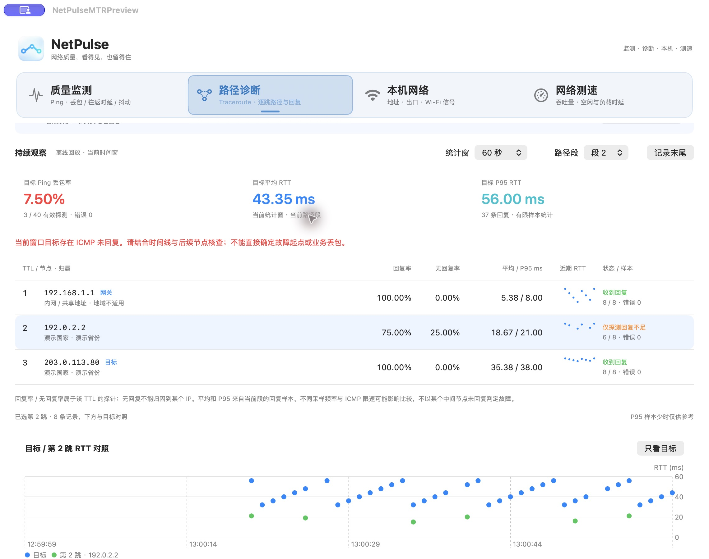
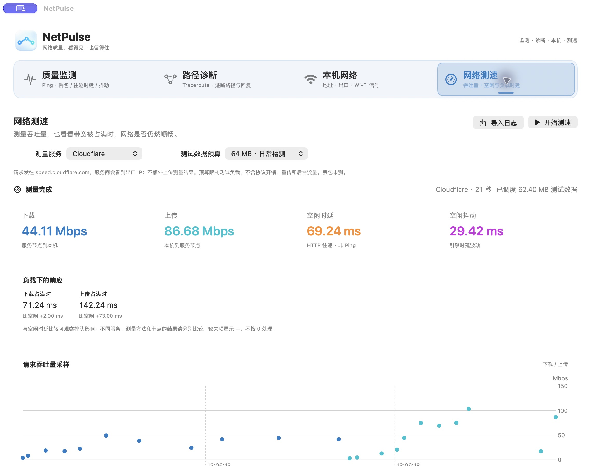

# NetPulse

一个面向排障的网络质量探测工具。持续观察丢包、往返时延和抖动，自动保存本地日志，也可以导入日志回放历史。当前提供 Ping 质量监测、Traceroute 路径诊断、本机网络信息和网络测速。

**当前版本：0.1 Preview**

目前仅支持 **macOS 14+**，使用 SwiftUI + Charts 实现，无需另装第三方运行环境（内置 Cloudflare JS 测速引擎）。未来可能扩展到 **Windows、Android 和 iOS**，具体实现与支持时间尚未确定。

## 功能总览

首页按「质量监测 → 路径诊断 → 网络测速 → 本机网络」排列：

| 工作区 | 适合做什么 | 主要结果 |
| --- | --- | --- |
| 质量监测 | 长时间观察目标是否稳定 | 最近 60 秒丢包率、五秒窗口 RTT / jitter、历史时间线 |
| 路径诊断 | 查看当前路径，持续追踪偶发异常 | Traceroute 快照、MTR 持续观察、逐跳回复与目标时序对照 |
| 网络测速 | 测吞吐量，以及满载时是否仍能及时响应 | 上下载 Mbps、空闲/负载时延、Cloudflare / 系统对照 |
| 本机网络 | 了解本机接入与 Wi-Fi 状态 | 局域网/网关/出口信息、信号趋势、周边 Wi-Fi 与连接变化 |


质量监测和路径诊断默认目标均为 `1.1.1.1`，可独立修改；打开应用、切换 TAB 或导入日志均不会自动开始探测或测速。本机网络页会读取本地信息，出口查询和周边 Wi-Fi 扫描仍需手动点击。以下功能截图记录各功能交付时的界面，导航顺序以本节为准。

## 快速开始

1. 打开本地构建的 `release/NetPulse.app`；尚未构建时，先执行 `./scripts/build.sh`。
2. **看稳定性**：在“质量监测”输入域名或 IPv4，点击“开始探测”。
3. **查路径**：切到“路径诊断”，选“快速查看”做一次扫描；选“持续观察（MTR）”并点击“开始观察”，可持续看逐跳与目标表现。会话开始后模式锁定，更换模式请新建测试。
4. **测速度**：在“网络测速”选服务与预算，再点击“开始测速”。测速会占用带宽，可能影响同时进行的业务和 Ping；系统对照无法按字节限流。
5. **看本机**：最后一个 TAB 展示本地接入与 Wi-Fi；需要时查询出口 IP 或授权后扫描周边 Wi-Fi。
6. **分享现场**：在对应工作区点击“在 Finder 中显示”或导出完整日志目录；接收方可在同类工作区导入回放。MTR 可先导入[合成演示日志](docs/examples/mtr-demo.csv)体验，不会发包。

| 操作 | 行为 |
| --- | --- |
| 暂停探测 / 暂停观察 | 停止采样并保存；Ping / MTR 可继续同一会话，MTR 继续时开启新路径段 |
| 暂停跟随 | 仅冻结浏览位置，后台采样继续 |
| 停止测速 | 结束本次测量，保留部分结果；再次开始创建新会话 |
| 新建测试 / 更换目标 | 只重建当前工作区，已有磁盘日志保留 |
| 关闭窗口 / `⌘Q` | 回收探测进程、保存记录后退出 |

## 质量监测


图中为 `1.1.1.1` 的一次短时实测，不代表目标的长期表现。

- **持续探测**：输入域名或 IPv4 地址，每秒调用一次系统 Ping，按固定五秒窗口汇总。
- **观察质量**：三张图展示窗口丢包率、平均往返时延（RTT）和 jitter，时间范围与悬停位置联动。
- **发现近期异常**：顶部显示最近 60 秒丢包率和丢失/有效探测数；会话概览保留全程累计值。
- **浏览历史**：选择时间范围、拖动历史滑块，或跳转上一处/下一处丢包；浏览时可以继续采集。
- **自动留存**：窗口统计保存为 CSV，逐包结果和原始输出保存为诊断文本。
- **导出与回放**：导出完整会话目录，或导入 CSV 还原统计曲线；兼容早期 JSONL 日志导入。

## 路径诊断

首页提供“质量监测 / 路径诊断 / 网络测速 / 本机网络”四个 TAB。质量监测与路径诊断各自输入目标、独立开始/停止，可以对不同 IP 同时运行。切换 TAB 不会中断另一项探测，运行状态显示在 TAB 名称上。目标、新建测试、导入和导出操作均属于当前工作区；更换地址只重建当前测试。本机网络无需输入目标；网络测速选择独立测量服务。

### 快速查看（Traceroute）

一次扫描获取当前可观测路径：

- 真实 ICMP 逐跳扫描，最多 30 TTL、每跳 3 个样本、总预算 60 秒；扫描中逐行展示结果。
- 展示实际目标 IP、出口网关和接口；网关按目标路由查询匹配，不直接假定第一跳就是网关。
- 表格保留同一 TTL 的多个地址，展示回复/样本数、平均 RTT 和颜色状态；中间未回复不当作转发丢包。
- 点击一跳查看单次扫描的 RTT 样本，明确区别于持续时序。
- 每次扫描创建独立 `route.csv` 与 `route-diagnostics.txt`，支持导出目录和离线导入回放。

### IP 地理归属

- **自动地理归属**：点击“下载并启用”，应用从 DB-IP 官方页面识别最新版本，自动下载、解压、校验并安装，支持进度与取消。安装一次后，每次启动自动加载，在扫描时离线补齐国家/省份；不上传路径 IP。设置中仍可手动导入 `.mmdb` 或 `.mmdb.gz`，也支持 GeoLite / GeoIP City、Country MMDB。
- 数据库保存到 `~/Library/Application Support/NetPulse/GeoIP/geolocation.mmdb`，设置中点击“下载最新数据库”即可更新，也可导入新版文件。界面及日志保留数据源和构建日期；地理归属只是参考，不能代表节点实测物理位置。内网、共享和保留地址不查询，未匹配显示未知。
- 可选导入 UTF-8 覆盖表，首行为 `ip,country,province`，精确 IP 匹配优先于数据库；覆盖表仅当前应用运行期间保留。历史日志回放使用当时的归属快照，不重新查询。


### 持续观察（MTR）

默认仍为快速查看，持续观察按用户点击启动：

- 向同一最终目标持续发送不同 TTL 的 ICMP 探针，使用系统 traceroute 轮询；每轮每 TTL 一个样本，至少间隔 5 秒、最长 35 秒，静默路径可能更慢。另约每秒 Ping 固定的目标 IPv4；不逐个 Ping 路由器 IP 冒充路径探测。
- 表格优先展示 TTL、节点/归属/网关、回复率、无回复率、平均 RTT、P95 与近期趋势；默认目标时间图，点击节点增加与目标的对照。统计窗可选 60 秒 / 5 分钟，可暂停跟随和浏览最近两小时。
- 中间未回复用灰色或橙色提示，不认定转发丢包；目标样本至少 5 个且出现未回复时红色提示。错误/取消不算丢包，缺失 RTT 留空，不把相邻行差值解释成链路时延。
- 观察到同一 TTL 回复 IP 改变时新建路径段，可能是路径变化或负载均衡；不同段分别统计。暂停保留日志，继续同一会话并开启新段。切换 TAB 不停止；新建测试才清空当前视图，旧日志保留。
- 每次新建创建 `mtr-<UUID>/mtr.csv` 与 `mtr-diagnostics.txt`，支持导出和离线导入；不随导入恢复发包。日志实时追加，内存最多保留两小时 / 60,000 条记录，导入上限 50 MB / 250,000 行。网关/接口为会话最新观察值，旧段不补猜历史网关。



截图使用[合成演示 CSV](docs/examples/mtr-demo.csv)，用于展示统计、分段和时序对照，**不是真实路径、地理归属或故障实测**。采样方法与验证边界见 [持续观察设计](docs/11-mtr-continuous-design.md)。

质量监测提供“对该目标做路径诊断”快捷入口，只带入目标，不自动扫描；路径页已有目标或结果时先确认，不直接覆盖。

## 网络测速



一次真实 Cloudflare 测速截图，仅代表当时网络和服务节点，不代表线路标称带宽或长期表现。

- **Cloudflare**：内置官方 1.15.0 引擎，按需开始；64 MB / 256 MB 测试数据预算，展示下载/上传 Mbps、HTTP 空闲时延/抖动、下载与上传负载时延及其增幅，以及每次请求的吞吐散点。未接 TURN，丢包显示未测。
- **macOS 系统对照**：调用系统 networkQuality，顺序测量，最长 30 秒，无字节流量上限；显示最终吞吐、可用时延及 RPM，不伪造实时曲线。不同服务与 Ping 的指标方法不同，应分别比较。
- **随时停止、切换 TAB 继续运行**：旧测量回收后才能再次开始。网络路径或观察到的本地配置发生变化时停止，保留部分结果。测速会占用带宽；同时运行的 Ping 诊断日志标记负载开始/结束，测速与周边 Wi-Fi 主动扫描相互避让。
- **独立 CSV 会话与历史**：每次创建 `~/Library/Logs/NetPulse/Speed/<UUID>/`，保存 `summary.csv`、`samples.csv`、本地网络快照；支持 Finder 定位、完整日志导出、最近 20 次历史和离线导入。缺失值留空，失败不冒充完整成功。
- 仅在点击开始后访问测量服务，服务商会看到出口 IP；关闭额外结果上报，本地网络快照只写本地。预算约束调度的测试负载，不包含协议开销/重传，也不等于运营商计费流量。流量有限时不保证跑满高速线路。

当前已验证一次 64 MB 档与 WebKit 小流量接通/停止、原生历史回放；系统真实满载、256 MB 档、多网络与不同系统版本仍需后续实测。设计与日志口径见 [实现和验证](docs/10-speedtest-implementation.md)。

## 本机网络

- 展示本机接入方式、局域网 IPv4、系统默认 IPv4/IPv6 网关；接口详情列出各接口的 IPv4/IPv6 地址及默认接口。
- 点击“查询出口 IP 与运营商”，通过 IP.SB HTTPS 查询该请求的出口 IP、ISP 和 ASN/组织；不发送局域网地址或 Wi-Fi 标识。结果保留查询时间，网络配置变化后标为过期。VPN/代理可能改变查询出口，显示的是出口网络归属，不一定等于宽带签约运营商。
- Wi-Fi 面板展示系统可提供的 RSSI、噪声、SNR、信道/频段/带宽、无线制式、安全模式和 Tx 协商速率；协商速率不等于实测网速。RSSI/SNR 的强弱分档为本工具排障提示，不能保证业务质量。
- SSID/BSSID 受 macOS 定位权限限制，点击“允许读取 Wi-Fi 名称”后才请求授权；不读取 GPS 位置。未授权、未连接或系统不支持时明确显示不可用，不补造读数。手机热点通常仍显示为 Wi-Fi，无法据此读取手机蜂窝信号。
- 每 2 秒后台读取本地信息，保留最近 10 分钟信号/噪声趋势；缺失、网络变化及暂停处断线。离开本 TAB 停止采样，返回恢复；手动暂停会保留到再次点击继续。出口查询始终按需发起。
- 补充系统默认 DNS、代理开关、低数据/高成本路径提示。系统路径可用不代表已经验证互联网连通；VPN/分域 DNS 可能另有规则。
- **周边 Wi-Fi**：授权后按需扫描，按频段筛选/搜索，展示 AP 标识、主信道、带宽、RSSI 与安全模式。图示主信道和信号，点击列表行可定位；不把扫描数量当成空口拥塞，也不自动推荐信道。扫描可能短时影响无线时延；“结束等待”会丢弃迟到结果，在系统扫描结束前不启动重复扫描。
- **连接变化记录**：记录观察到的连接、网络名称、接入点和信道变化。暂停期间重新建立基线，不补猜漫游事件或切换耗时。
- “导出快照”生成独立 `.netpulse` 目录：`network.txt` 为可读信息，`wifi.csv` 为信号样本，`wifi-events.csv` 为连接变化；已有扫描时另含 `wifi-scan.csv`。文件包含本机地址和可读取的本机/周边 Wi-Fi 标识。当前未提供本机快照回放。

NetSpot、WiFi Explorer 与 Apple 无线诊断的展示调研、字段口径和后续规划见 [本机网络设计](docs/07-local-network-design.md) 和 [周边 Wi-Fi 设计](docs/08-wifi-nearby-design.md)。已实现主信道分布；宽信道实际占用轮廓、空口利用率与场地热力图尚未实现。

## 日志与回放

各工作区分别保存日志，默认位置如下：

| 工作区 | 目录（相对 `~/Library/Logs/NetPulse/`） | 文件 |
| --- | --- | --- |
| 质量监测 | `<session-id>/` | `session.csv`、`diagnostics.txt` |
| 快速路径 | `route-<UUID>/` | `route.csv`、`route-diagnostics.txt` |
| MTR 持续观察 | `mtr-<UUID>/` | `mtr.csv`、`mtr-diagnostics.txt` |
| 网络测速 | `Speed/<UUID>/` | `summary.csv`、`samples.csv`、本地网络快照文本 |
| 本机网络 | 点击“导出快照”时选择位置 | `.netpulse` 目录，内含网络文本和 Wi-Fi CSV；暂不支持回放 |

建议导出完整会话目录后压缩分享，保留配套诊断文件。文件可能包含目标/路径 IP、本地地址和可读取的 Wi-Fi 标识。导入须在对应工作区进行，不会自动恢复发包。

质量监测日志示例：

```text
~/Library/Logs/NetPulse/<session-id>/
├── session.csv        # 会话信息与每五秒窗口统计
└── diagnostics.txt    # 事件、逐包结果和系统 Ping 原始输出
```

质量监测 CSV 文件开头记录目标地址、应用版本、日志版本、开始时间、操作系统与统计口径。以下是简化格式示例（非实测数据）：

```csv
# NetPulse-Version: 0.1.0
# Log-Version: 2
# Target: example.com
...
timestamp,loss_pct,rtt_avg_ms,jitter_ms,sent,received,errors,window_status,rtt_status,jitter_status,rtt_min_ms,rtt_max_ms,window_index
2026-10-29T06:00:00.000Z,0,23.5,2.1,5,5,0,complete,ok,ok,21,26,0
2026-10-29T06:00:05.000Z,100,,,5,0,0,complete,all_lost,insufficient_pairs,,,1
```

数值缺失留空，由状态列解释原因；零表示有效的零值。时间使用带毫秒的 UTC ISO 8601。质量监测 CSV 数值最多保留六位小数并去除尾零；其他日志的字段与精度见各自规范。

- **导出**：生成 `.netpulse` 会话目录，包含 CSV 和诊断文件，可压缩后发送。文件含目标、IP 和原始输出。
- **导入**：选择会话目录或单个 CSV，恢复窗口曲线、样本数和累计统计。逐包输出请查看配套 `diagnostics.txt`；窗口 CSV 不包含逐包明细。
- **数据加工**：读取时跳过以 `#` 开头的元信息，例如 `pandas.read_csv("session.csv", comment="#")`。

质量监测字段见 [CSV 日志规范](docs/03-csv-log-format.md)，MTR 追加式元信息/样本见 [持续观察设计](docs/11-mtr-continuous-design.md)，测速汇总与样本配对见 [测速实现](docs/10-speedtest-implementation.md)。

## 质量监测指标口径

| 指标 | 口径 |
| --- | --- |
| 最近 60 秒丢包率 | 最近 12 个已结束五秒窗口的总丢失数 ÷ 总有效探测数；不直接平均窗口百分比 |
| 窗口丢包率 | 每五秒窗口中的超时数 ÷ 有效探测数；系统或 DNS 错误不计入分母 |
| 平均往返时延（RTT） | 当前所选窗口成功回复的平均 RTT，单位 ms，不除以二 |
| Jitter | 同窗相邻成功包 RTT 差绝对值的平均值；遇丢包或采集空档断开，不跨窗 |

开始不足一分钟时显示实际统计覆盖秒数。近期卡片按已结束窗口更新，可能滞后一个窗口及回复等待时间；浏览历史或离线回放时，显示浏览位置之前的 60 秒。暂停时不足五秒的尾窗标为 `partial`。

全丢包时 RTT 缺失，无有效配对时 jitter 缺失。曲线不跨缺失窗口连线。Ping 反映 ICMP 可达性与往返表现，业务质量应结合实际业务测量判断。

## 从源码构建

需要提供 `swiftc` 的 Xcode / Command Line Tools，以及可用的 macOS SDK。使用当前机器架构构建：

```sh
./scripts/build.sh
```

输出为 `release/NetPulse.app`。构建脚本使用本地 ad-hoc 签名，尚未进行 Apple 签名公证；当前不提供通用二进制包，Intel 构建尚未实测。

运行验证：

```sh
./scripts/test.sh
```

测试覆盖 Ping 输出解析、丢包与 jitter 边界、近期丢包率加权、CSV 空值和异常行、真实 loopback 探测、回放一致性、新会话独立文件，以及退出时保存在途请求与关闭日志。路径测试另覆盖多地址、超时/不可达、真实 ICMP loopback、取消与总预算、本地归属 CSV 和路径日志回放。MTR 增加比率/P95、错误排除、多轮回环与目标 Ping、暂停继续、旧回调隔离、路径段、轮次超时和严格 CSV 回放测试。地理数据库测试包含官方 MMDB 测试库、24/28/32 位树、指针与长度编码、损坏文件和资源上限、安装恢复、gzip、更新失败保护、覆盖优先级及回放快照。

本机网络测试覆盖信号零值/缺失、分档阈值、SNR、趋势分段与保留期、出口解析/过期/异步竞态、手动暂停、快照和 CSV 导出；另验证真实本机读取及第三工作区隔离。外部出口服务的实时验证单独按需运行，不纳入每次离线回归。测速测试覆盖预算、字段校验、CSV、停止与旧回调隔离；真实 Cloudflare 小流量测试单独按需执行。

## 预览版边界

- 质量监测在内存中保留最近约 24 小时窗口；MTR 为最近两小时 / 最多 60,000 条记录，本机 Wi-Fi 趋势为最近 10 分钟。CSV 和诊断文本不自动删除。
- Ping / 路径 CSV 导入上限 50 MB，MTR 另限制 250,000 行；测速的汇总和样本文件各限 2 MB。当前同步读取，尚未实现超大历史索引、选段导出及磁盘占用展示。
- 暂不支持 IPv6 Ping/路径探测及 UDP/TCP MTR；本机信息可展示 IPv6 地址。Windows、Android 和 iOS 尚未支持。地理数据库首次需联网下载，不随应用打包；目前未做多家数据库的真实节点覆盖率对比。
- 每秒启动一次单包系统 Ping，按请求启动的单调时间分窗；进程启动和 DNS 解析可能影响实际发包间隔。
- 完整回归与真实回环 MTR 多轮/暂停/继续已通过；公网切路、多路径、长时间耐久和休眠恢复仍需实机验证。测速已实测 Cloudflare 64 MB 档，系统满载与 256 MB 档尚未实测。
- 异常退出可能留下未正常收尾的会话和部分结果，回放不会把它们当作完整测试；诊断文本可辅助排查。

## 功能研究

网络测速的候选服务、可嵌入能力、流量/指标口径和工作区设计，见 [测速接入调研](docs/09-speedtest-research.md)。当前已实现 Cloudflare 和系统对照，验证边界见 [实现记录](docs/10-speedtest-implementation.md)。

路径诊断的完整调研、交互方案及分期计划，见 [研究与设计建议](docs/04-route-diagnostics-research.md) 和 [需求与实现设计](docs/05-route-diagnostics-spec.md)。当前已实现快速路径与本地 MMDB 自动地理归属，持续观察已实现系统 ICMP 轮询，原生高频逐探针引擎为后续增量。数据源比较与实现边界见 [IP 地理归属方案](docs/06-ip-geolocation-options.md)。

应用图标源图、生成提示词及导出说明见 [图标资源说明](assets/README.md)。构建时自动生成并打包 macOS 图标。

## 项目结构

```text
NetPulse/
├── README.md
├── assets/             # 应用图标与内置 Cloudflare 测速资源
├── src/NetPulse/       # 数据模型、CSV、会话采集与桌面界面
├── scripts/            # 构建和验证脚本
├── tests/              # 核心指标与会话测试
├── release/            # 本机应用产物，不进入 Git
└── docs/               # 设计、格式规范与截图
```

继续阅读：[需求与版本规划](docs/01-visual-ping-requirements.md) · [实现与验证记录](docs/02-implementation.md) · [CSV 日志规范](docs/03-csv-log-format.md)
