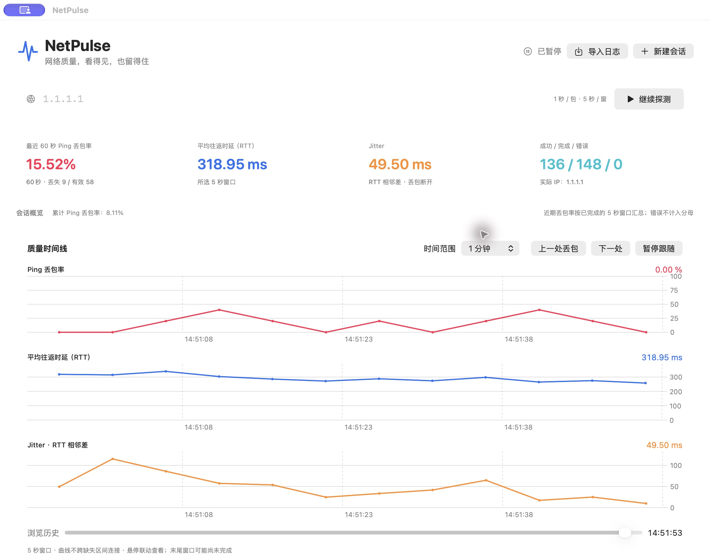
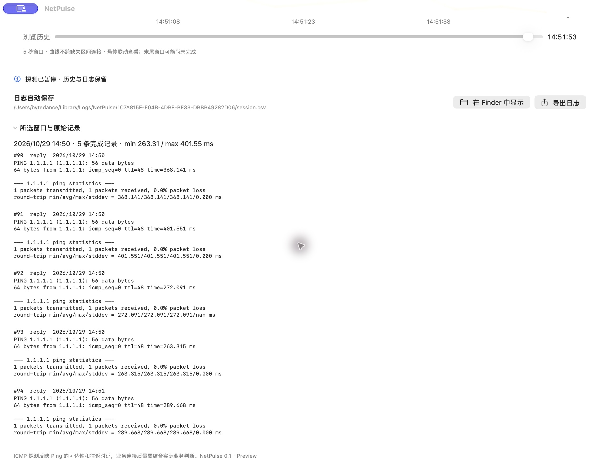

# NetPulse


一个面向排障的网络质量探测工具。持续观察丢包、往返时延和抖动，自动保存本地日志，也可以导入日志回放历史。当前实现调用系统 Ping 与 Traceroute 进行探测。

**当前版本：0.1 Preview**

目前仅支持 **macOS 14+**，使用 SwiftUI + Charts 实现，无第三方运行依赖。未来可能扩展到 **Windows、Android 和 iOS**，具体实现与支持时间尚未确定。

## 界面预览


新版首页截图，来自尚未开始测试的独立界面检查实例。目标输入和操作位于各自 TAB 内，两个目标彼此独立。

质量监测与路径诊断初始目标均为 `1.1.1.1`，可分别修改，启动时不会自动探测。TAB 选中项使用浅蓝填充、边框与阴影区分。



实际应用截图，探测目标为 `1.1.1.1`。图中数据仅代表截图时本机的一次短时探测，不代表该目标的长期网络质量。



日志自动保存，可在 Finder 中定位；所选窗口可以展开查看系统 Ping 的原始输出。

## 能做什么

- **持续探测**：输入域名或 IPv4 地址，每秒调用一次系统 Ping，按固定五秒窗口汇总。
- **观察质量**：三张图展示窗口丢包率、平均往返时延（RTT）和 jitter，时间范围与悬停位置联动。
- **发现近期异常**：顶部显示最近 60 秒丢包率和丢失/有效探测数；会话概览保留全程累计值。
- **浏览历史**：选择时间范围、拖动历史滑块，或跳转上一处/下一处丢包；浏览时可以继续采集。
- **自动留存**：窗口统计保存为 CSV，逐包结果和原始输出保存为诊断文本。
- **导出与回放**：导出完整会话目录，或导入 CSV 还原统计曲线；兼容早期 JSONL 日志导入。

## 工作区与路径诊断

首页提供“质量监测 / 路径诊断”两个 TAB，各自输入目标、独立开始/停止，可以对不同 IP 同时运行。切换 TAB 不会中断另一项采集，运行状态显示在 TAB 名称上。目标、新建测试、导入和导出操作均属于当前工作区；更换地址只重建当前测试。

路径诊断当前支持 **快速查看（Traceroute）**：

- 真实 ICMP 逐跳扫描，最多 30 TTL、每跳 3 个样本、总预算 60 秒；扫描中逐行展示结果。
- 展示实际目标 IP、出口网关和接口；网关按目标路由查询匹配，不直接假定第一跳就是网关。
- 表格保留同一 TTL 的多个地址，展示回复/样本数、平均 RTT 和颜色状态；中间未回复不当作转发丢包。
- 点击一跳查看单次扫描的 RTT 样本，明确区别于持续时序。
- **自动地理归属**：点击“下载并启用”，应用从 DB-IP 官方页面识别最新版本，自动下载、解压、校验并安装，支持进度与取消。安装一次后，每次启动自动加载，在扫描时离线补齐国家/省份；不上传路径 IP。设置中仍可手动导入 `.mmdb` 或 `.mmdb.gz`，也支持 GeoLite / GeoIP City、Country MMDB。
- 数据库保存到 `~/Library/Application Support/NetPulse/GeoIP/geolocation.mmdb`，设置中点击“下载最新数据库”即可更新，也可导入新版文件。界面及日志保留数据源和构建日期；地理归属只是参考，不能代表节点实测物理位置。内网、共享和保留地址不查询，未匹配显示未知。
- 可选导入 UTF-8 覆盖表，首行为 `ip,country,province`，精确 IP 匹配优先于数据库；覆盖表仅当前应用运行期间保留。历史日志回放使用当时的归属快照，不重新查询。


- 每次扫描创建独立 `route.csv` 与 `route-diagnostics.txt`，支持导出目录和离线导入回放。

**持续观察（MTR）尚未实现，界面明确禁用。** 后续将增加每跳持续采样、节点与目标的时序对照，以及历史路径分段，完整要求见 [路径诊断需求与设计](docs/05-route-diagnostics-spec.md)。

质量监测提供“对该目标做路径诊断”快捷入口，只带入目标，不自动扫描；路径页已有目标或结果时先确认，不直接覆盖。下一版计划增加“本地网络”工作区（独立选择接口，无远端目标），当前尚未展示入口。

## 快速开始

1. 打开本地构建的 `release/NetPulse.app`。
2. 输入域名或 IPv4 地址，例如 `example.com` 或 `1.1.1.1`，点击“开始探测”。
3. 查看三项质量曲线；需要分析刚发生的问题时，点击“暂停跟随”或拖动历史滑块。
4. 点击“在 Finder 中显示”找到日志，或用“导出日志”保存完整会话。

“暂停探测”停止发送新请求，并等待在途请求结束；“暂停跟随”仅冻结浏览位置，后台继续探测和写日志。“回到实时”恢复跟随最新数据。

切换目标请点击当前 TAB 的“新建测试”或“更换目标”。只清空当前工作区，另一项测试继续运行；每次新测试创建独立日志，暂停后继续仍写原文件。点击窗口 X 或按 `⌘Q` 会停止探测、保存最后的统计并退出；如仍有请求在途，会等待其完成，最长约 4.5 秒。

## 日志与回放

默认保存到：

```text
~/Library/Logs/NetPulse/<session-id>/
├── session.csv        # 会话信息与每五秒窗口统计
└── diagnostics.txt    # 事件、逐包结果和系统 Ping 原始输出
```

CSV 文件开头记录目标地址、应用版本、日志版本、开始时间、操作系统与统计口径。以下是简化格式示例（非实测数据）：

```csv
# NetPulse-Version: 0.1.0
# Log-Version: 2
# Target: example.com
...
timestamp,loss_pct,rtt_avg_ms,jitter_ms,sent,received,errors,window_status,rtt_status,jitter_status,rtt_min_ms,rtt_max_ms,window_index
2026-10-29T06:00:00.000Z,0,23.5,2.1,5,5,0,complete,ok,ok,21,26,0
2026-10-29T06:00:05.000Z,100,,,5,0,0,complete,all_lost,insufficient_pairs,,,1
```

数值缺失留空，由状态列解释原因；零表示有效的零值。时间使用带毫秒的 UTC ISO 8601，数值最多保留六位小数并去除尾零。

- **导出**：生成 `.netpulse` 会话目录，包含 CSV 和诊断文件，可压缩后发送。文件含目标、IP 和原始输出。
- **导入**：选择会话目录或单个 CSV，恢复窗口曲线、样本数和累计统计。逐包输出请查看配套 `diagnostics.txt`；窗口 CSV 不包含逐包明细。
- **数据加工**：读取时跳过以 `#` 开头的元信息，例如 `pandas.read_csv("session.csv", comment="#")`。

完整字段、状态与校验规则见 [CSV 日志规范](docs/03-csv-log-format.md)。

## 指标口径

| 指标 | 口径 |
| --- | --- |
| 最近 60 秒丢包率 | 最近 12 个已结束五秒窗口的总丢失数 ÷ 总有效探测数；不直接平均窗口百分比 |
| 窗口丢包率 | 每五秒窗口中的超时数 ÷ 有效探测数；系统或 DNS 错误不计入分母 |
| 平均往返时延（RTT） | 当前所选窗口成功回复的平均 RTT，单位 ms，不除以二 |
| Jitter | 同窗相邻成功包 RTT 差绝对值的平均值；遇丢包或采集空档断开，不跨窗 |

开始不足一分钟时显示实际统计覆盖秒数。近期卡片按已结束窗口更新，可能滞后一个窗口及回复等待时间；浏览历史或离线回放时，显示浏览位置之前的 60 秒。暂停时不足五秒的尾窗标为 `partial`。

全丢包时 RTT 缺失，无有效配对时 jitter 缺失。曲线不跨缺失窗口连线。Ping 反映 ICMP 可达性与往返表现，业务质量应结合实际业务测量判断。

## 从源码构建

需要提供 `swiftc` 的 Xcode / Command Line Tools，以及可用的 macOS SDK。使用当前机器架构构建：

```sh
./scripts/build.sh
```

输出为 `release/NetPulse.app`。构建脚本使用本地 ad-hoc 签名，尚未进行 Apple 签名公证；当前不提供通用二进制包，Intel 构建尚未实测。

运行验证：

```sh
./scripts/test.sh
```

测试覆盖 Ping 输出解析、丢包与 jitter 边界、近期丢包率加权、CSV 空值和异常行、真实 loopback 探测、回放一致性、新会话独立文件，以及退出时保存在途请求与关闭日志。路径测试另覆盖多地址、超时/不可达、真实 ICMP loopback、取消与总预算、本地归属 CSV 和路径日志回放。地理数据库测试包含官方 MMDB 测试库、24/28/32 位树、指针与长度编码、损坏文件和资源上限、安装恢复、gzip、更新失败保护、覆盖优先级及回放快照。

## 预览版边界

- 图表在内存中保留最近约 24 小时窗口；CSV 和诊断文本持续写入磁盘，不自动删除。
- CSV 导入上限 50 MB，当前同步读取；尚未实现超大历史文件索引、选定时间段导出及磁盘占用展示。
- 暂不支持 IPv6 探测、WiFi 信号信息及持续 MTR；Windows、Android 和 iOS 尚未支持。地理数据库首次需联网下载，不随应用打包；目前未做多家数据库的真实节点覆盖率对比。
- 每秒启动一次单包系统 Ping，按请求启动的单调时间分窗；进程启动和 DNS 解析可能影响实际发包间隔。
- 24 小时耐久与系统休眠恢复尚未完成实机验证。异常退出时，尚未汇总的窗口可能未写入 CSV，诊断文件可辅助排查。

## 功能研究

路径诊断的完整调研、交互方案及分期计划，见 [研究与设计建议](docs/04-route-diagnostics-research.md) 和 [需求与实现设计](docs/05-route-diagnostics-spec.md)。当前已实现快速路径与本地 MMDB 自动地理归属，持续 MTR 为后续增量。数据源比较与实现边界见 [IP 地理归属方案](docs/06-ip-geolocation-options.md)。

应用图标源图、生成提示词及导出说明见 [图标资源说明](assets/README.md)。构建时自动生成并打包 macOS 图标。

## 项目结构

```text
NetPulse/
├── README.md
├── assets/             # 应用图标源图与 macOS 图标
├── src/NetPulse/       # 数据模型、CSV、会话采集与桌面界面
├── scripts/            # 构建和验证脚本
├── tests/              # 核心指标与会话测试
├── release/            # 本机应用产物，不进入 Git
└── docs/               # 设计、格式规范与截图
```

继续阅读：[需求与版本规划](docs/01-visual-ping-requirements.md) · [实现与验证记录](docs/02-implementation.md) · [CSV 日志规范](docs/03-csv-log-format.md)
