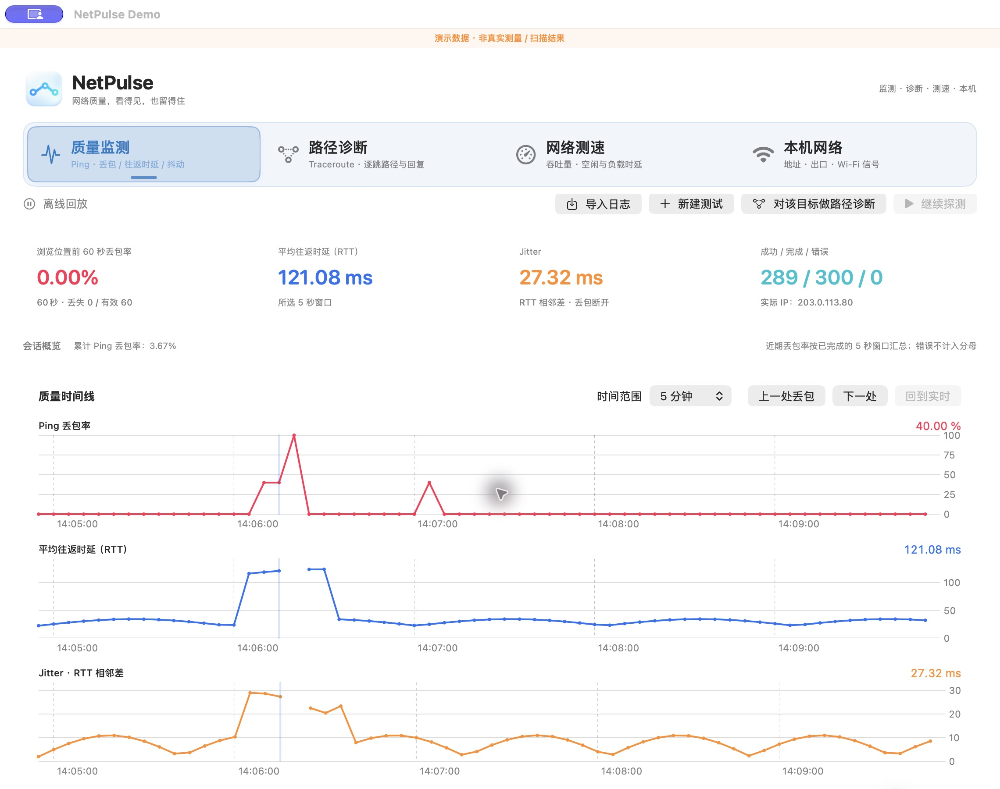
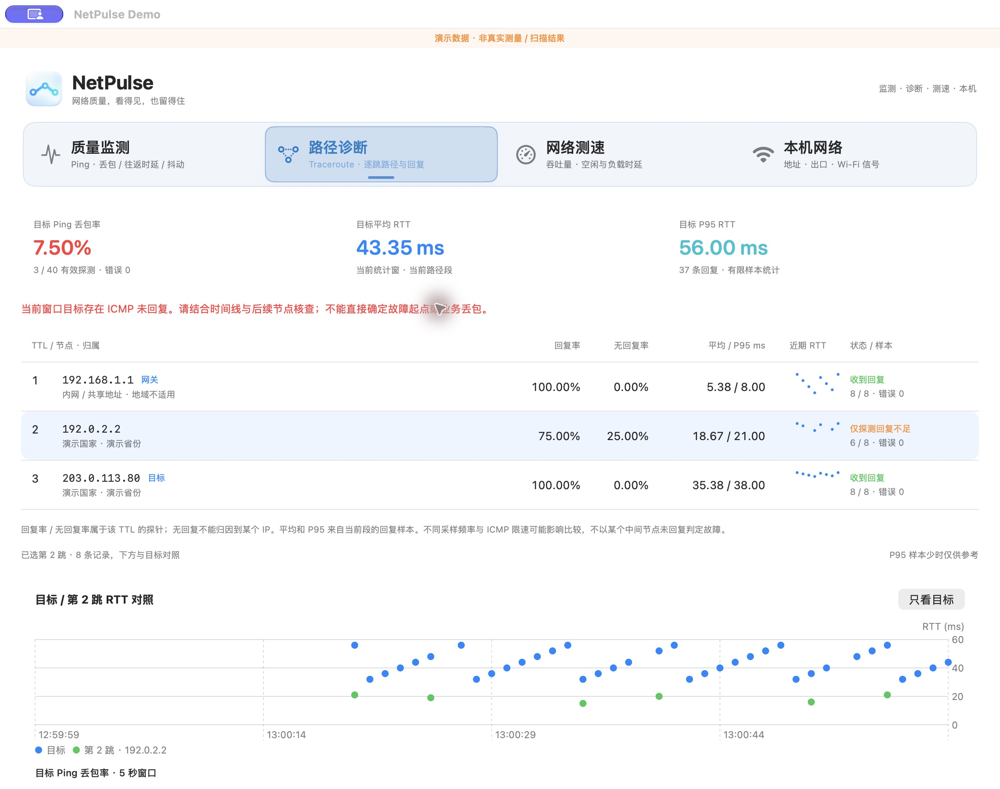
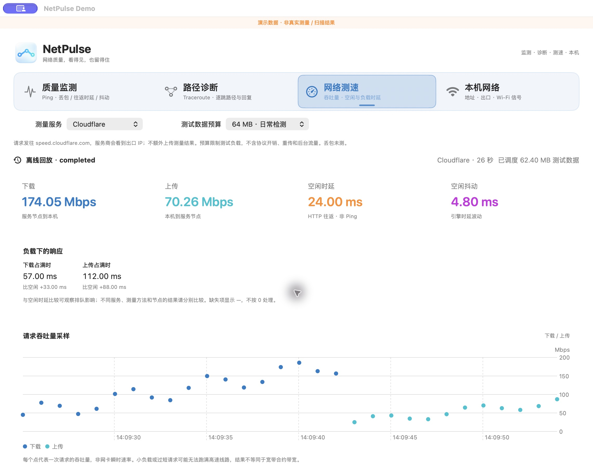
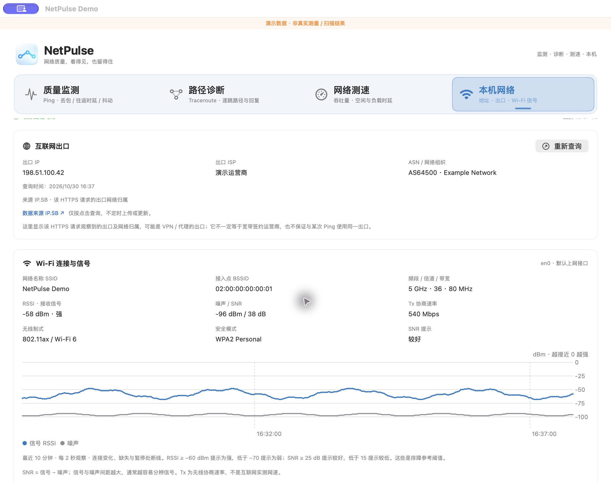

# NetPulse

网络排障工具，提供质量监测、路径诊断、测速与本机网络信息，结果可保存为本地 CSV。

**0.1 Preview · 当前支持 macOS 14+**。未来可能支持 Windows、Android 和 iOS。

以下截图均使用合成演示数据，展示波动与交互，不代表真实网络测量或地理归属。

## 1. 质量监测

持续观察一个目标，找出什么时候开始丢包、时延升高或抖动。

- 每秒 Ping，按五秒窗口绘制丢包率、往返时延（RTT）和 jitter。
- 查看最近 60 秒表现，暂停跟随、浏览历史，快速跳到丢包位置。
- 自动保存日志，支持暂停后继续、导出及离线回放。



## 2. 路径诊断

先看经过哪些节点，再持续观察节点与目标是否同时出现异常。

- **Traceroute**：一次扫描展示逐跳地址、网关、国家/省份与回复情况；地理数据库安装后离线查询。
- **MTR 持续观察**：展示回复率、平均/P95 RTT 和近期趋势；点击节点，与目标时间线对照。
- 地址变化或暂停后继续时分段统计，支持历史浏览、日志导出与回放。

中间节点不回复可能是 ICMP 限速，不能据此认定转发丢包。当前 MTR 使用系统 ICMP 轮询，静默路径会使刷新变慢。



## 3. 网络测速

除了上下载速度，也观察带宽被占满时的响应变化。

- **Cloudflare**：选择 64 / 256 MB 测试数据预算，查看吞吐采样、空闲时延、抖动及上下载负载时延。
- **macOS 系统对照**：调用 networkQuality，展示吞吐与系统响应能力 RPM。
- 随时停止，每次独立存档；支持历史查看、导入和导出。

测速会占用带宽。Cloudflare 预算不含协议开销和重传；系统对照没有字节流量上限。HTTP 时延、RPM 与 Ping RTT 的口径不同。



## 4. 本机网络

查看本机接入、出口与 Wi-Fi 状态，辅助区分本地无线问题和公网问题。

- 展示局域网 IP、网关、DNS 与代理配置；按需查询出口 IP、运营商和 ASN。
- 观察 Wi-Fi 信号、噪声、SNR、信道和协商速率，以及最近 10 分钟的信号趋势。
- 按需扫描周边 Wi-Fi，查看信道分布和连接变化，导出网络快照。

SSID/BSSID 读取受系统定位权限限制，不读取 GPS；Wi-Fi 协商速率不等于实测网速。本机快照暂不支持回放。



## 使用与日志

打开 `release/NetPulse.app`，在对应 TAB 设置目标或服务后开始。质量监测、路径诊断和测速独立运行，切换 TAB 不会中断；新建测试只重建当前工作区，原日志保留。

日志默认保存在 `~/Library/Logs/NetPulse/`。在对应页面点击“在 Finder 中显示”或导出完整会话目录，即可分享现场；导入不会自动发包。CSV 缺失值留空，详细字段见 [日志规范](docs/03-csv-log-format.md)。

## 构建与开发

需要 macOS 14+ 及 Xcode / Command Line Tools，无需另装运行环境：

```sh
./scripts/build.sh   # 输出 release/NetPulse.app
./scripts/test.sh    # 回归测试，含本机回环探测
```

当前使用本地 ad-hoc 签名，未进行 Apple 签名公证。IPv6 Ping/路径探测、UDP/TCP MTR 和跨平台支持尚未实现；长时间运行及多种真实网络环境仍需验证。

设计与实现：[版本规划](docs/01-visual-ping-requirements.md) · [MTR](docs/11-mtr-continuous-design.md) · [测速](docs/10-speedtest-implementation.md) · [本机网络](docs/07-local-network-design.md) · [Wi-Fi](docs/08-wifi-nearby-design.md)。截图使用生产视图和[演示夹具](tests/ReadmePreview.swift)，可通过 `./scripts/readme-preview.sh` 构建独立预览。
